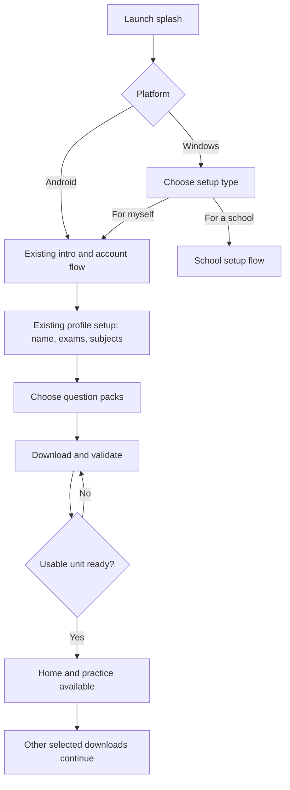
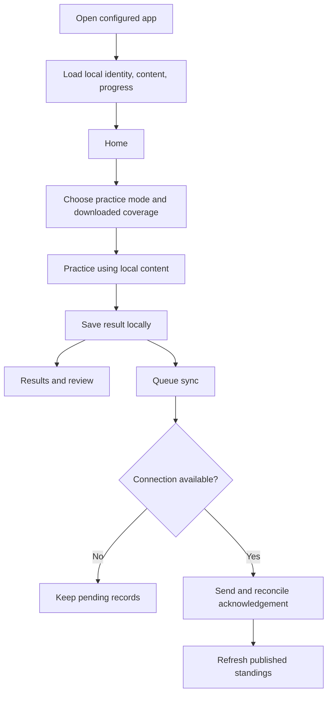
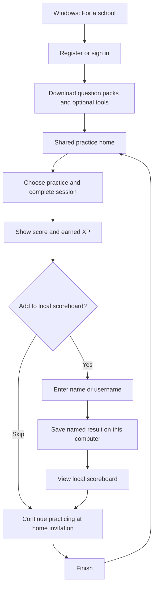

# ExamPrep A1 — Android and Windows product requirements

Status: Draft for discussion; not approval to begin implementation.

Growth requirement: V1 must support future feature expansion and broader school distribution through modular feature boundaries, versioned local storage/content contracts, reliable synchronization, and isolated school/personal contexts. Keep launch scope simple; do not prebuild speculative school management features. See the companion Flutter handoff architecture proposal.

## 1. Product objective

Build the existing ExamPrep A1 student experience in Flutter for Android and Windows. Preserve the PWA's appearance, navigation, screens, interaction patterns, and learning behavior, with additions for explicit content downloads, reliable offline operation, and shared school use on Windows.

After initial online account setup and content downloads, a learner must be able to launch the app, practice, review answers, and retain progress without internet. Downloaded content is the source for practice even when connected. Connectivity enables downloads, content updates, account services, and synchronization.

## 2. Confirmed scope

- Android: personal learner experience.
- Windows: personal learner experience and shared school mode.
- Flutter is the chosen application framework.
- Preserve all student application screens and their sheets/dialogs, except Learning World.
- Exclude the public marketing landing page and Learning World, including its entry points.
- Personal accounts are required; preserve current registration and profile setup, removing the guest alternative in this product.
- Questions must be downloaded before use. Users can select an exam body, subject, and multiple years, including all available years.
- Users can practice a ready download while remaining selected content downloads in the background.
- Flashcards and formulas are optional downloads selected by the user.
- Persist personal learning activity locally and sync when internet returns.
- Retain last synced leaderboard standings offline, with their last update time.
- Live 1v1 requires internet.
- Personal mode preserves existing Free/Premium rules.
- School mode initially unlocks all applicable features without paid restrictions.
- School students do not create accounts or complete personal onboarding. At the end of practice, they can append a name or username to their result for a simple local scoreboard.
- School distribution is free in this first version. Each optionally saved result is a separate school leaderboard entry; results are not accumulated by student name.
- After school practice, show a non-blocking invitation to continue practicing at home using the personal product.

Bundled starter questions are not a confirmed launch requirement. The primary flow is online setup followed by explicit downloads.

## 3. Users

| User | Need |
| --- | --- |
| Personal learner | Download chosen content, study without data, retain progress, and sync to their existing account. |
| School setup contact | Register or sign in once, prepare a shared Windows installation, and download content. |
| Student at a shared computer | Start practice quickly, see a result, optionally add a name to the local scoreboard, and leave the computer ready for the next student. |

School mode is a shared practice experience. The current web school's roster, cohorts, subscriptions, and reporting dashboard are not automatically requirements for this app.

## 4. Existing product inventory

This inventory comes from source inspection, not a completed visual audit. Before implementation, capture reference screenshots and inventory nested sheets, dialogs, and error/empty states.

| Area | Existing routes or components | Flutter treatment |
| --- | --- | --- |
| Launch and entry | Launch splash; `/onboarding`; intro slides; auth panel | Match current visuals; require a personal account. |
| Profile setup | `/student/profile?setup=1`; profile setup gate | Preserve name, exams, and subjects flow; introduce download guidance afterward. |
| Home | `/student/home` | Preserve home, activity, challenges, and navigation; use local data offline. |
| Practice setup | `/student/practice`; setup sheet | Preserve topic, Quick 5, custom, study, Speed Round, and other existing setup options; indicate downloaded coverage. |
| Mock exam | `/student/practice/mock` | Preserve setup; require all content needed for the selected exam before starting. |
| Session and review | `/student/practice/session`; session components | Preserve question display, calculator, timers, explanations, summary, and review. |
| Learning | `/student/learn`; flashcards and flashcard session | Preserve learning tools; download their content on demand; remove Learning World. |
| Battle | `/student/battle`; setup, session, missions, battle leaderboard | Preserve screens; make local computer battles use downloaded content. Define refresh rules for missions/rankings. |
| Live 1v1 | `/student/battle/1v1`; create, lobby, match; invite entry | Preserve experience with an explicit online requirement. |
| Progress | `/student/progress`; `/student/progress/trends` | Calculate available progress locally; reconcile with synced history. |
| Leaderboards | `/student/leaderboard`; `/student/leaderboard/hall` | Persist last received standings; refresh online. |
| Daily challenge | `/student/daily-challenge` | Preserve screen; settle offline challenge provisioning and ranking rules. |
| Profile and settings | `/student/profile`; nested sheets | Preserve applicable settings, goals, plan, subjects, and activity; define offline save states. |
| Legacy subject route | `/student/subjects` | Currently redirects to profile setup; preserve intent rather than inventing a separate screen. |

Admin, reviewer, partner, and marketing routes are outside this student-app scope. External community/career links remain external services; their local entry screens can open offline but remote destinations require connectivity.

## 5. New screens and interface states

1. Windows setup choice: “For myself” / “For a school.”
2. School sign-in and registration: school name and contact details, with exact fields to be finalized.
3. Initial content selection after personal or school setup.
4. Download library: available, selected, downloading, ready, interrupted, and update-available content.
5. Pack details: exam, subject, years, size, downloaded coverage, version, and readiness.
6. Download management: progress, retry, storage information, and removal confirmation.
7. Offline/sync status: saved on this device, waiting to sync, synced, and action required.
8. Shared school practice home and local scoreboard.
9. School result naming at the end of a session.
10. School session completion prompt: continue practicing at home, with a clearly displayed personal-product address and an optional open-link action when connected.

These may reuse sheets or existing layouts; a listed state does not necessarily need its own full page.

## 6. Functional requirements

### Accounts and startup

- Preserve current phone/email and password registration/sign-in and existing profile completion steps.
- Initial registration/sign-in requires internet. An already configured installation must launch offline without forcing a fresh server sign-in merely because it is disconnected.
- Retain the configured personal or school mode across restarts.
- Keep personal account data separate from school data and other accounts on the same installation.
- Account switching, logout, and pending-sync handling need explicit behavior before implementation.

### Downloaded content

- Offer question selection by exam body, subject, and years. Support selecting all available years for a subject.
- Show expected size and progress. Clearly distinguish available-to-download content from ready-to-use content.
- Download everything required to use a pack: question text, choices, answers, explanations, passages, images, diagrams, and relevant metadata.
- Bundle required application assets locally, including fonts, icons, and learning interface assets.
- Recommend content based on the existing exam/subject profile without silently downloading the entire library.
- Allow optional flashcard/formula downloads independently of question downloads.
- Make completed units usable while remaining selected units download. Recommended readiness unit: one complete subject-year pack; final granularity remains open.
- Validate a unit before marking it ready. An incomplete download must not produce a broken offline session.
- Recover from interrupted downloads without discarding already completed units.
- Detect insufficient storage and provide a clear recovery action.
- Removing downloaded content must not silently delete learning history or results.
- Background work means downloads can continue during in-app practice. Continuation while minimized or closed depends on platform support and must not be promised without validation.

### Content updates

- Check for updates when connected and notify users about updates to downloaded content.
- Keep the last complete version usable until its replacement is downloaded and validated.
- Preserve active-session questions and scoring when a pack is updated.
- Retain version information so saved results refer to the content actually answered.
- Whether updates require a tap or may install automatically is an open policy decision.

### Practice and local persistence

- Read practice content locally in both connected and disconnected use.
- Restrict setup to downloaded coverage, or explain which missing packs must be downloaded.
- Preserve existing mode behavior, scoring, explanations, and XP rules.
- Save answers and relevant session state durably during personal practice; save completed results before showing success.
- An unexpected close must not erase completed results or unsynced activity.
- Offline progress, history, and XP must remain available after restart.
- Multi-subject mocks must verify all required content before starting.

### Synchronization and standings

- Queue personal learning activity durably and retry after reconnection without requiring a new practice attempt.
- Give each event/session a stable identity so retries do not duplicate scores or XP.
- Keep pending records until the server acknowledges them; do not silently discard old unsynced records.
- Reconcile server acknowledgements and account history without counting local activity twice.
- Distinguish local provisional XP/progress from published leaderboard standings. Offline activity cannot instantly change a shared server leaderboard.
- Store last synced standings persistently. Failed refreshes and restarts must preserve them.
- Display last update time; before the first successful refresh, show a clear “Connect to load standings” state.
- Server validation and eligibility rules for offline results entering competitive rankings remain to be defined.

### Personal entitlements

Preserve the existing policy in `src/lib/plans.js`, rather than creating a second independent product policy. At inspection, it specifies:

| Feature | Existing Free access |
| --- | --- |
| Quick 5 | Available |
| Topic practice | First five topics per subject |
| Custom / study / Speed Round | One shared session per day |
| Mock exams | Premium |
| Computer battle | Two per day |
| Live friend battle | Premium and internet required |
| Flashcards, explanations, progress, leaderboards, daily challenge | Available under existing policy |

The current policy also includes a 14-day new-account trial. Reuse current account entitlements and expiry data. Decide offline expiry, usage reconciliation across devices, and renewal behavior before implementation. Downloaded files do not by themselves grant paid-feature access. Do not delete files merely because an entitlement changes.

### Shared school mode

- Register/sign in as a school and download selected content on the Windows installation.
- Unlock applicable practice and learning features without student subscription gates.
- Allow students to start practice without personal accounts, subject personalization, or individual profile setup.
- On completion, show score and earned XP; offer a name/username entry to add the result to the local scoreboard.
- Saving to the school leaderboard is optional. A student can skip naming/saving and finish normally; skipping creates no leaderboard entry.
- Each saved completed session creates its own entry with name/username, score, earned XP, and time. Reusing a name does not merge results or accumulate XP across sessions.
- Save accepted scoreboard entries on that computer across restarts and offline use.
- Start the next student's practice with a clean answer state.
- Do not attribute school results to the setup contact's personal XP or national account ranking.
- Do not introduce unfinished-session recovery for named school students, cloud student profiles, or cross-computer school rankings in this first scope.
- After each completed school practice session, offer a brief, dismissible invitation to use the personal product at home, whether the student saves their result or skips.
- Suggested copy: “Continue practicing at home. Get a personalized practice experience with ExamPrep A1.” Display and link the confirmed destination: https://www.examprepa1.online/.
- The invitation and address must display offline. Opening the website or downloading the personal app requires internet; dismissing the invitation returns to the shared home without requiring registration.
- This prompt supports discovery of the personal product through free school distribution. It must not imply school results transfer to a personal account.
- Scoreboard reset/removal controls and access protection remain to be specified.

## 7. User stories and acceptance criteria

| ID | User story | Acceptance criteria |
| --- | --- | --- |
| US-01 | As a learner, I want familiar onboarding. | Existing intro, phone/email auth, and profile steps remain recognizable; no personal guest bypass; downloads follow setup. |
| US-02 | As a learner, I want to choose my downloads. | I can select an exam, subject, and multiple/all years and see size and progress. |
| US-03 | As a learner, I want to start while other content downloads. | A validated ready unit can be used without depending on unfinished units; remaining downloads continue during in-app practice. |
| US-04 | As a learner, I want complete offline questions. | In airplane mode, downloaded questions, passages, diagrams, options, and explanations render correctly. |
| US-05 | As a learner, I want to retain my work. | Completed results, local progress, and pending sync survive an app restart without internet. |
| US-06 | As a learner, I want progress to sync automatically. | Reconnection uploads queued activity; repeating the upload does not duplicate the session or XP. |
| US-07 | As a learner, I want updated questions. | Available updates are visible; a failed update leaves the previous complete content usable. |
| US-08 | As a learner, I want optional study tools. | I can separately download flashcards/formulas and use them after disconnecting. |
| US-09 | As a learner, I want standings available offline. | Last synced standings survive restarts, show their update time, and remain visible after a failed refresh. |
| US-10 | As a personal user, I expect my current plan. | Existing feature restrictions apply locally under the agreed offline entitlement policy; school mode does not inherit them. |
| US-11 | As a school contact, I want a simple shared setup. | Windows school registration/sign-in leads to downloads and a shared practice home without student profile setup. |
| US-12 | As a school student, I want to optionally put my name on my result. | Completing practice shows score/XP; saving creates a separate named local school leaderboard entry, even if the same name was used before; skipping creates no entry; the next session starts clean. |
| US-13 | As a user, I want clear connectivity requirements. | Local screens remain usable offline; live 1v1 and remote services explain when a connection is needed. |
| US-14 | As a school student, I want to know how to practice at home. | After completion, whether I save or skip, I see a dismissible personal-product invitation and website address even offline; no personal registration is required to finish the school session. |

## 8. User flows

### A. First personal use

If offline before initial account setup, explain that a connection is needed and offer retry. If setup succeeds but downloads fail, retain setup and reopen the download step without repeating registration.

### B. Returning personal user

### C. Optional content and updates

Library → choose question packs / flashcards / formulas → inspect coverage and size → download → validate → ready offline. Interrupted downloads show retry. Available updates show a clear action; the previous version remains usable until replacement succeeds.

### D. School setup and repeated use

Saving is optional and every saved result remains separate. The home-practice invitation is dismissible and appears on both completion paths. There is no named unfinished-session resume flow.

## 9. Offline behavior matrix

| Capability | Offline behavior | Connection needed for |
| --- | --- | --- |
| Launch and navigation | Open installed screens and local state | Initial account authentication |
| Downloaded practice and mocks | Run, score, and review locally subject to plan and content coverage | New packs and updates |
| Downloaded flashcards/formulas | Fully usable | New content and updates |
| Computer battle | Local play with downloaded content | Shared ranking refresh |
| Progress and history | Show locally available activity | Cross-device reconciliation |
| Leaderboards/Hall of Fame | Show last persisted standings and timestamp | Current shared standings |
| Live 1v1 | Screen available with connection-required state | Match creation, joining, and live play |
| School scoreboard | Save and display results on this computer | No connection required after setup |
| Daily/weekly challenges and missions | Screens available; cached/provisioned content policy unresolved | New schedules and shared ranking updates |
| Profile/settings | Local display and applicable local edits | Credentials, account services, renewal, remote updates |

“Every screen offline” means navigation and useful local states survive disconnection; it cannot mean receiving new remote information without a connection.

## 10. Launch validation

- Compare Android and Windows screens against the existing PWA at corresponding viewport sizes, including sheets and session states.
- After setup and downloads, use airplane mode to launch, practice, review, use optional tools, and restart without losing results.
- Interrupt a download/update and verify complete older content remains usable.
- Verify question media renders without remote requests.
- Restore connectivity after multiple offline sessions and verify each result syncs once.
- Confirm persisted standings survive restart and failed refresh.
- Verify personal Free/Premium boundaries and unrestricted school access.
- Complete consecutive school sessions and verify clean answer state and persistent named scoreboard entries.
- Save two school results under the same name and verify two separate entries. Skip saving and verify no entry is created. Confirm both paths show a dismissible home-practice invitation offline.
- Confirm Learning World and its entry points are absent.

## 11. Decisions to settle before implementation

| Decision | Current proposal or question |
| --- | --- |
| First usable download | One complete subject-year pack; confirm appropriate granularity. |
| School leaderboard ordering | Entries are confirmed separate and optional; define sort order and tie handling. |
| Home-practice invitation copy | Destination confirmed as https://www.examprepa1.online/; finalize wording and placement. |
| Offline entitlement expiry | Define expiry/grace, local daily limits, device-clock handling, and cross-device usage reconciliation. |
| Competitive offline results | Define server validation and eligibility for national/daily rankings. |
| Challenges and missions | Define advance downloadable schedules, expiry, offline completion, and refresh behavior. |
| Account lifecycle | Define logout, account switching, retained downloads, and pending-sync protection. |
| Update policy | Manual update, automatic update, or a user preference? |
| School administration | Define minimal protection for changing school setup, deleting downloads, and clearing the scoreboard. |
| School live play | Shared students have no personal identity; decide how existing 1v1 identity/invites apply in school mode. |
| Supported OS versions | Set minimum Android and Windows versions after checking Flutter and required platform capabilities. |
| Performance targets | Set download-size, storage, startup, and low-end device targets using representative content/devices. |

## 12. Implementation planning boundary

No Flutter implementation is included in this draft. Once product behavior is agreed, produce the final screen/state inventory and UX references, then the technical plan for local storage, pack manifests/versioning, sync contracts, entitlements, and platform background work. Reuse existing backend identities, scoring, and product rules where suitable; verify API support rather than assume the web endpoints already provide downloadable packs.

## Source references

- `src/app/onboarding/page.js`; `src/components/onboarding/AuthPanel.jsx`
- `src/lib/profileSetup.js`; `src/app/student/profile/page.js`
- `src/components/student/StudentNav.jsx`; `src/app/student/layout.js`
- `src/app/student/practice/page.js`; `src/app/student/practice/session/page.js`
- `src/app/api/student/questions/route.js`
- `src/app/student/learn/page.js`; `src/app/student/learn/world/page.js`
- `src/lib/localSessionSync.js`; `public/sw-offline.js`
- `src/lib/plans.js`; `src/app/school/dashboard/page.js`
